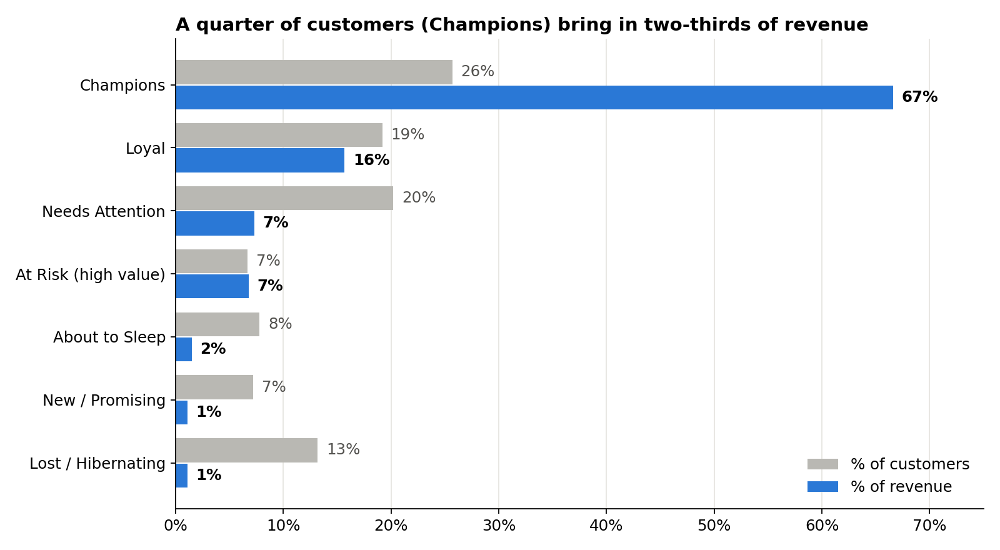
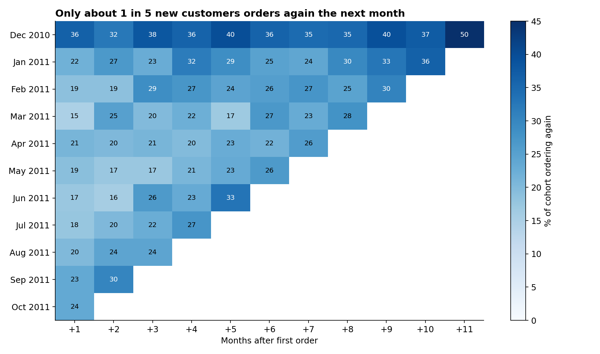
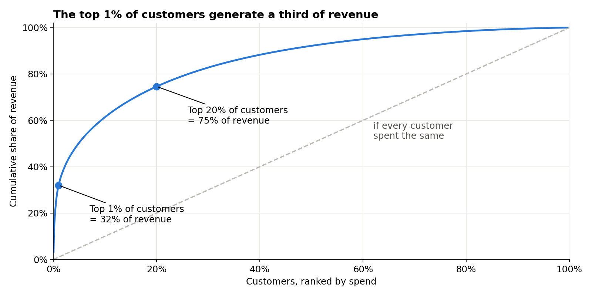
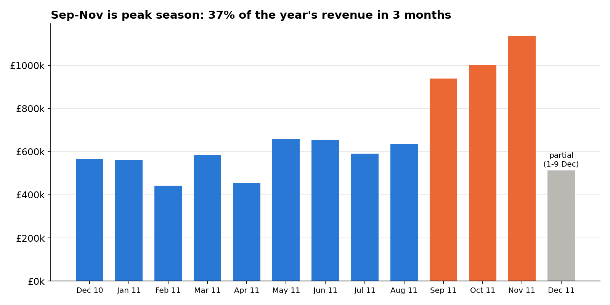

# Online Retail Customer Analytics: Retention, RFM & Basket Analysis

**SQL-first analysis of 540k transactions from a UK online wholesaler. It answers three questions every e-commerce team asks: who are our best customers, are new customers coming back, and what should we sell together?**



---

## The problem

The company sells giftware online, mostly to small retailers. Management wants to know:

1. Which customers drive the business, and which valuable ones are slipping away?
2. Do first-time customers come back?
3. Which products should be bundled or cross-sold?

**Dataset:** 541,909 raw invoice lines → after cleaning: 4,334 customers · 18,402 orders · 37 countries · Dec 2010 – Dec 2011 · revenue in GBP (£).

## Key findings

| # | Finding | Evidence |
|---|---------|----------|
| 1 | **Revenue is highly concentrated.** The top 1% of customers bring in 32% of revenue, and the top 20% bring in 75%. | `06_pareto_customers.sql` |
| 2 | **Champions carry the business.** 1,115 customers (26%) produce £5.8M, which is **67% of revenue**. | `05_segment_summary.sql` |
| 3 | **£592k of revenue is at risk.** 290 high-value customers (avg 4.8 orders each) have not ordered for 131 days on average. | `04_rfm_segments.sql` |
| 4 | **Most new customers don't come back quickly.** Only **~20%** of new customers in 2011 ordered again the following month. | `03_cohort_retention.sql` |
| 5 | **But repeat buyers are where the money is.** 35% of customers bought only once; the other 65% generated **93% of revenue**. | `04_rfm_segments.sql` |
| 6 | **Strong Q4 seasonality.** Sep–Nov 2011 brought in 37% of the year's revenue, and November peaked at £1.14M. | `02_monthly_kpis.sql` |
| 7 | **Clear cross-sell pairs.** Matching sets are bought together 30–60x more often than chance (e.g. Regency tea plates in green + pink: lift 61, 75% confidence). | `08_product_pairs.sql` |
| 8 | **International customers spend more each.** UK = 92% of revenue, but German and French customers spend about 15% more per customer than UK customers. | `07_country_performance.sql` |

## Recommendations

| Action | Target | Why |
|--------|--------|-----|
| **Win-back campaign** (personal email + time-limited offer) | 290 *At Risk (high value)* customers | Protects up to £592k. Winning back even 25% ≈ £150k. |
| **Second-order programme** (discount on 2nd order within 30 days) | New customers | Month-1 retention is ~20%, and repeat buyers generate 93% of revenue. |
| **VIP account management** | 1,115 *Champions*, especially the top 1% (43 customers) | 32% of revenue depends on 43 accounts, so losing even one hurts. |
| **"Complete the set" bundles and recommendations** | Top product pairs | Pairs with lift > 30 are ready-made bundles. |
| **Stock and staff up from August** | Operations | Sep–Nov is 37% of annual revenue. |

## Charts

| | |
|---|---|
|  |  |



### Top product pairs (market basket)

| Product A | Product B | Orders together | Confidence A→B | Lift |
|-----------|-----------|----------------:|---------------:|-----:|
| Regency tea plate green | Regency tea plate pink | 202 | 75% | 61.5 |
| Regency sugar bowl green | Regency milk jug pink | 206 | 77% | 52.0 |
| Poppy's Playhouse bedroom | Poppy's Playhouse living room | 205 | 65% | 47.4 |
| Set/6 red spotty paper cups | Set/6 red spotty paper plates | 236 | 83% | 46.9 |
| Poppy's Playhouse living room | Poppy's Playhouse kitchen | 215 | 85% | 45.4 |

*Lift = how many times more often the pair is bought together than if purchases were random. Full list: `outputs/tables/08_product_pairs.csv`.*

## Method

**1. Data cleaning in SQL** ([`00_build_clean_tables.sql`](sql/00_build_clean_tables.sql)). 72% of raw rows were kept.

| Step | Rows left |
|------|----------:|
| Raw rows | 541,909 |
| Remove exact duplicates | 536,641 |
| Remove cancelled invoices (`C…`) | 527,390 |
| Remove rows with no CustomerID (25% of rows) | 392,732 |
| Remove zero / negative quantity or price | 392,692 |
| Keep real products only (drop postage, fees, manual adjustments) | **391,150** |

**2. Analysis: 8 business questions, one SQL file each**

| Question | SQL file | SQL skills used |
|----------|----------|-----------------|
| How much data is usable? | [`01_data_quality.sql`](sql/01_data_quality.sql) | `UNION ALL` |
| Monthly revenue, orders, AOV, growth | [`02_monthly_kpis.sql`](sql/02_monthly_kpis.sql) | `COUNT(DISTINCT)`, `LAG()` |
| Do new customers return? | [`03_cohort_retention.sql`](sql/03_cohort_retention.sql) | `MIN() OVER (PARTITION BY)`, `DATE_DIFF`, `FIRST_VALUE()` |
| Customer segmentation | [`04_rfm_segments.sql`](sql/04_rfm_segments.sql) | `NTILE(5)`, `CASE WHEN` rules |
| Revenue by segment | [`05_segment_summary.sql`](sql/05_segment_summary.sql) | `SUM(...) OVER ()` for % of total |
| 80/20 check | [`06_pareto_customers.sql`](sql/06_pareto_customers.sql) | running total `ROWS UNBOUNDED PRECEDING` |
| Best markets | [`07_country_performance.sql`](sql/07_country_performance.sql) | `HAVING` |
| Products bought together | [`08_product_pairs.sql`](sql/08_product_pairs.sql) | `SELF JOIN`, support / confidence / lift |

**RFM scoring:** Recency, Frequency and Monetary are each scored 1–5 (quintiles) as of 10 Dec 2011. Segments come from R and F scores, e.g. *Champions* = R≥4 and F≥4; *At Risk (high value)* = R≤2 and F≥4.

**Limitations**
- Data ends 9 Dec 2011, so December 2011 is partial and is excluded from cohort retention.
- The Dec 2010 cohort includes existing customers (the data starts then), so its retention is higher than for truly new customers.
- 25% of rows have no CustomerID. These were excluded from customer analysis, so revenue here is lower than the company's total sales.

## Tools

- **SQL (DuckDB):** cleaning and all analysis in plain `.sql` files
- **Python:** pandas and matplotlib for running queries and making charts
- **Git/GitHub:** version control

## How to run

```bash
pip install -r requirements.txt
python src/fetch_data.py      # optional: re-download the raw data (already included)
python src/run_analysis.py    # runs sql/00 ... 08 -> outputs/tables/
python src/make_charts.py     # builds charts     -> outputs/charts/
```

To test a single query: `python src/run_sql.py sql/04_rfm_segments.sql`

## Project structure

```
online-retail-customer-analytics/
├── data/raw/online_retail.csv.gz   # raw data (compressed)
├── sql/                            # 00 = cleaning, 01-08 = business questions
├── src/                            # download, SQL runners, charts
├── outputs/
│   ├── tables/                     # result of every query (CSV, Power BI-ready)
│   └── charts/
└── requirements.txt
```

## Data source

Chen, D. (2015). *Online Retail* [Dataset]. UCI Machine Learning Repository. https://archive.ics.uci.edu/dataset/352/online+retail (CC BY 4.0).

---
*Author: Nurul Alia Iman · [LinkedIn](https://www.linkedin.com/in/alia-iman-91b11022b) · [Email](mailto:nurulaliaimank@gmail.com)*
